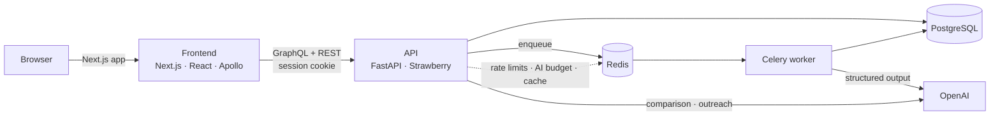

# TalentFlow AI

**AI-assisted applicant screening, end to end.** Candidates apply with a PDF resume; TalentFlow
parses it into structured data, scores it against a job-specific rubric with resume evidence for
every claim, and gives recruiters a pipeline to review, compare, annotate, and contact candidates.
The AI supports decisions; people make them.

<!-- Live demo: add the URL here after deployment. -->

## Try the demo

1. Open the landing page and click **Try it as a recruiter**. You are signed in to a demo
   workspace with no sign-up.
2. Open **Senior Backend Engineer**. Browse scored applicants, open Aisha Rahman's profile to see
   the evidence behind her score, and download her resume.
3. Click **Screen unscored applicants** to watch two waiting applicants get scored live.
4. Select two or three applicants and choose **Compare**.
5. Back on the landing page, apply to a role using the **sample resume** and watch your
   application move through *reading resume → matching against the role*. Then find yourself in
   the recruiter view.

All companies, people, and applications in the demo are fictional, and demo data resets nightly.

## Features

| | |
| --- | --- |
| **Resume parsing** | PDF text extraction plus LLM structured output (skills, roles, dates, education) validated with Pydantic |
| **Job rubrics** | A weighted scoring rubric is generated from each new job description |
| **Evidence-based scoring** | Per-category scores with rationale and resume evidence; the overall score is computed deterministically from rubric weights rather than trusted from the model |
| **Candidate comparison** | Trade-off summary across 2-5 evaluated candidates, cached by input fingerprint |
| **Recruiter pipeline** | Drag-and-drop stages, bulk updates, notes, and an audited status history |
| **Outreach drafts** | AI-drafted emails with an edit → approve → send workflow (delivery is simulated) |
| **Applicant progress** | Applicants see live screening progress through a signed, scoped status token |
| **Safety controls** | Cookie sessions, company-scoped data, a daily AI budget, per-IP rate limits, a honeypot, and prompt-injection-aware prompts |

## Architecture



- **Frontend:** Next.js App Router, TypeScript, Tailwind CSS, Apollo Client
- **API:** FastAPI, Strawberry GraphQL, Tortoise ORM with Aerich migrations
- **Background work:** Celery on Redis. Resume parsing, rubric generation, and scoring run as
  independent, retryable tasks that chain automatically.
- **AI:** OpenAI structured outputs into Pydantic schemas (`gpt-4.1-mini` by default)

## Run locally

Prerequisites: Python 3.11+, Node 22+, Docker Desktop (runs Postgres and Redis), and an OpenAI
API key.

```bash
make setup     # env files, dependencies, Postgres + Redis, migrations, demo data
               # then add OPENAI_API_KEY to backend/.env
make dev       # API, worker, and frontend together; Ctrl+C stops them
make exit      # stop everything, including the databases (data is kept)
```

Open <http://localhost:3000>. Run `make` to see every command, including database inspection
(`make db-show TABLE=jobs`), SQL (`make db-query SQL="..."`), and migrations
(`make migrate NAME=...` then `make upgrade`). If your database has data from an older seed,
`make reset-demo` replaces it with the demo dataset.

See [backend/README.md](backend/README.md) for the API, authentication, cost controls, and
GraphQL examples, and [frontend/README.md](frontend/README.md) for routes and checks.

## Tests

```bash
make test     # or run each suite:
cd backend && python -m unittest discover -s tests
cd frontend && npm run typecheck && npm run lint && npm run test:public-application \
  && npm run test:application-integration && npm run test:selection
```

## Future work

- Multi-company sign-up and per-company workspaces (the data model is already company-scoped)
- Real email delivery behind the existing delivery interface
- S3 resume storage behind the existing storage interface
- Deployment configuration and CI
