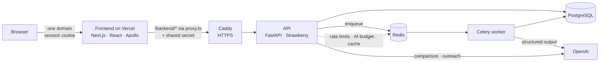

# TalentFlow AI

**AI-assisted applicant screening, end to end.** Candidates apply with a PDF resume; TalentFlow
parses it into structured data, scores it against a job-specific rubric with resume evidence for
every claim, and gives recruiters a pipeline to review, compare, annotate, and contact candidates.
The AI supports decisions; people make them.

**Live demo:** <https://talent-flow-ai-ten.vercel.app>

## Try the demo

1. Open the landing page and click **Try it as a recruiter**. You get your own private demo
   workspace (a copy of the sample company) with no sign-up.
2. Open **Senior Backend Engineer**. Browse scored applicants, open Aisha Rahman's profile to see
   the evidence behind her score, and download her resume.
3. Click **Screen unscored applicants** to watch two waiting applicants get scored live.
4. Select two or three applicants and choose **Compare**.
5. Back on the landing page, apply to a role using the **sample resume** and watch your
   application move through *reading resume → matching against the role*. Then find yourself in
   the recruiter view.

All companies, people, and applications in the demo are fictional. Each visitor gets a private
copy of the demo workspace, deleted after 24 hours, so nobody sees anyone else's changes. AI
usage is capped per day, so AI actions may pause once the daily budget is spent.

## Features

| | |
| --- | --- |
| **Resume parsing** | PDF text extraction plus LLM structured output (skills, roles, dates, education) validated with Pydantic |
| **Job rubrics** | A weighted scoring rubric is generated from each new job description |
| **Evidence-based scoring** | Per-category scores with rationale and resume evidence; the overall score is computed deterministically from rubric weights rather than trusted from the model |
| **Candidate comparison** | Trade-off summary across 2-5 evaluated candidates, cached by input fingerprint |
| **Recruiter pipeline** | Drag-and-drop stages, bulk updates, notes, and an audited status history |
| **Outreach drafts** | AI-drafted emails with an edit → approve → send workflow (delivery is simulated) |
| **Applicant progress** | Applicants see live screening progress through a signed, scoped status token |
| **Private demo workspaces** | Every demo visitor gets an isolated copy of the sample company (no AI calls to create it); copies expire after 24 hours and are capped in number |
| **Safety controls** | Cookie sessions, company-scoped data, an API reachable only through the frontend proxy, a daily AI budget, per-IP rate limits, a honeypot, and prompt-injection-aware prompts |

## Architecture



- **Frontend:** Next.js App Router, TypeScript, Tailwind CSS, Apollo Client
- **API:** FastAPI, Strawberry GraphQL, Tortoise ORM with Aerich migrations
- **Background work:** Celery on Redis. Resume parsing, rubric generation, and scoring run as
  independent, retryable tasks that chain automatically.
- **AI:** OpenAI structured outputs into Pydantic schemas (`gpt-4.1-mini` by default)
- **Hosting:** the frontend runs on Vercel. The API, worker, scheduler, PostgreSQL, Redis, and
  Caddy run with Docker Compose on one small VPS.
- **One-domain requests:** the browser only talks to the frontend's domain. A Next.js proxy
  forwards `/backend/*` to the API, so the session cookie stays first-party (it works in Safari
  and private windows) and no CORS setup is needed. The API rejects requests that don't come
  through the proxy.

## Run locally

Prerequisites: Python 3.11+, Node 22+, Docker Desktop (runs Postgres and Redis), and an OpenAI
API key.

```bash
make setup     # env files, dependencies, Postgres + Redis, migrations, demo data
               # then add OPENAI_API_KEY to backend/.env
make dev       # API, worker, and frontend together; Ctrl+C stops them
make exit      # stop everything, including the databases (data is kept)
```

Open <http://localhost:3000>. Run `make` to see every command, including database inspection
(`make db-show TABLE=jobs`), SQL (`make db-query SQL="..."`), and migrations
(`make migrate NAME=...` then `make upgrade`). If your database has data from an older seed,
`make reset-demo` replaces it with the demo dataset.

See [backend/README.md](backend/README.md) for the API, authentication, cost controls, and
GraphQL examples, and [frontend/README.md](frontend/README.md) for routes and checks.

## Deployment

The production setup costs about $6 a month: a free Vercel Hobby project for the frontend and a
2 vCPU / 4 GB Hetzner server running [compose.prod.yaml](compose.prod.yaml). Caddy gets HTTPS
certificates automatically, using a free [sslip.io](https://sslip.io) hostname, so no domain is
needed. Deploys are manual: `git pull` and `docker compose up -d --build` on the server, while
Vercel redeploys the frontend on every push.

[DEPLOYMENT.md](DEPLOYMENT.md) has the step-by-step guide: server setup, environment variables,
Vercel configuration, and troubleshooting.

## Tests

```bash
make test     # or run each suite:
cd backend && python -m unittest discover -s tests
cd frontend && npm run typecheck && npm run lint && npm run test:public-application \
  && npm run test:application-integration && npm run test:selection
```

## Future work

- Self-serve company sign-up (the data model and demo workspaces are already company-scoped)
- Real email delivery behind the existing delivery interface
- S3 resume storage behind the existing storage interface
- CI/CD (deploys are manual today)
